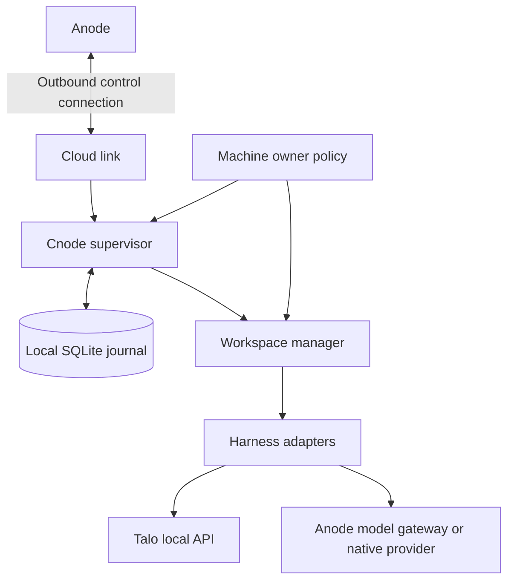

# Cnode

**Your machine, connected to the team.**

Cnode is the local client and execution daemon for Anode. It connects installed coding harnesses to shared projects, prepares isolated workspaces, executes authorized assignments and returns structured results and evidence.

**Status: documentation starter, design version 0.1, 15 November 2026.** This repository contains specifications, diagrams, illustrative configuration and protocol fixtures. It does not contain a runnable client. CLI names and interfaces are proposed.

## Where Cnode fits

| Component | Responsibility |
| --- | --- |
| **Anode** — companion repository | Project authority, knowledge, history, scheduling, grants and accepted outcomes. |
| **Cnode** — this repository | Local execution authority: daemon, workspaces, harness processes, checkpoints and delivery. |
| **Talo** — independent local service | Deterministic tools, reusable pipelines and optional local decision models. |

The machine owner chooses what capacity to contribute. An assignment must satisfy both Anode authorization and local policy. A machine may host several workers, but a worker is a capability identity, not a user account or a process.

## What Cnode will provide

- Enrollment, capability advertisement and a durable outbound control connection.
- Per-run checkout, context materialization, package pins and resource limits.
- Explicit adapters for launch, follow-up, resume, cancellation and result capture.
- Durable assignment receipts and sequenced events that survive disconnects.
- Controlled repository submissions, with no Git-host credential required in mediated mode.
- Talo integration, local package installation and machine-owner pause/stop controls.

Cnode does not own shared project state, automatically grant itself more capacity, guarantee a sleeping machine can be woken, or turn every desktop subscription into a model API.

## Read first

| Document | Use |
| --- | --- |
| [Architecture](docs/architecture.md) | Blocks, processes and responsibility boundaries. |
| [Execution and recovery](docs/execution-and-recovery.md) | Job lifecycle, crash recovery, sleep and cancellation. |
| [Harness adapters](docs/harness-adapters.md) | Interface and verification gates for each harness. |
| [Workspace and Git](docs/workspaces-and-git.md) | Source preparation, isolation and result exchange. |
| [Talo and packages](docs/talo-and-packages.md) | Local capabilities, sharing and package trust. |
| [Local state](docs/local-state.md) | SQLite records, journal and cleanup rules. |
| [CLI and configuration](docs/cli-and-configuration.md) | Proposed user interface and deployment. |
| [Protocol](docs/protocol.md) | Pinned copy of Anode's draft 0.1 contract. |
| [Security](docs/security.md) | Owner control, credentials and containment. |
| [Implementation plan](docs/implementation-plan.md) | Ordered tickets and integration milestones. |
| [Decisions](docs/decisions.md) | Accepted boundaries and unresolved platform choices. |

## Starting development

1. Read `AGENTS.md`, execution recovery and the protocol.
2. Implement C01–C03 with a fake Anode endpoint and a deterministic fake harness.
3. Demonstrate duplicate delivery, restart and reconnect before enabling real agents.
4. Verify one harness adapter and integrate Talo's first exact helper.

Python is the proposed initial implementation language. The initial reference OS is **macOS**, consistent with Talo's existing design; Linux follows after the first integration. This is a planning default, not a claim of implemented support. A later Rust runner can implement the same wire contract.

For standalone use, run a local Anode server alongside Cnode. Cnode does not embed a second implementation of project orchestration. Talo remains independently usable without either service.

No remote repository or working installation is included. Choose a software license before public release. See [contribution guidance](CONTRIBUTING.md) and [contract ownership](contracts/README.md).
