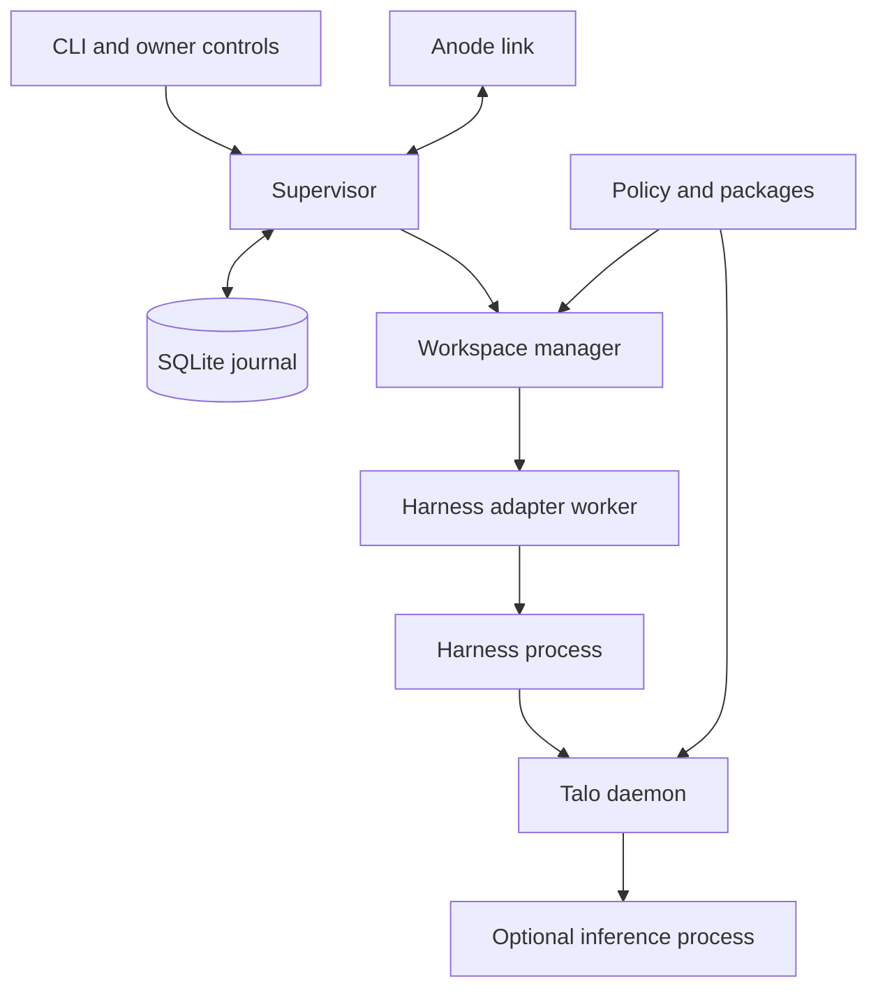

# Cnode architecture

## Process model

One daemon per OS user supervises execution. Its control loop, local journal and heartbeats must remain responsive when a harness or Talo model hangs. Run harnesses and model inference in separate processes, with explicit resource limits and bounded output queues.

| ID / block | Responsibility | Boundary |
| --- | --- | --- |
| C1 Link | Enrollment, renewal, long poll, heartbeat and reconciliation. | No project scheduling logic. |
| C2 Supervisor | Durable command acceptance, slots, run lifecycle, cancellation and recovery. | Cannot override Anode or owner authorization. |
| C3 Workspaces | Exact source, paths, environment, isolation and artifact collection. | Worktree separation alone is not a security sandbox. |
| C4 Adapters | Discover, start, follow up, resume, collect and cancel supported harness sessions. | Capabilities must be measured per harness/version. |
| C5 Talo integration | Workspace-bound local tool access, health and optional supervision. | Talo owns its modules, result storage and model lifecycle. |
| C6 Package manager | Fetch pinned releases, verify hashes, check compatibility and install. | Registry visibility is not execution permission. |
| C7 Policy and secrets | Owner scope, limits, allowed projects, mounts, network and credential grants. | Prompt content cannot widen permissions. |
| C8 Journal and artifacts | Commands, runs, events, receipts, transfer progress and recovery state. | Not a writable replica of shared project state. |
| C9 Local interface | CLI, status, diagnostics and user-service lifecycle. | Local endpoints require user-scoped access. |

## Repository boundary

Cnode integrates Talo as a versioned local dependency, not by copying its internals. It may start/stop Talo when configured as its supervisor, or attach to an existing user-owned daemon. Stopping Cnode must not kill an independently managed Talo instance.

Anode is a remote dependency with an explicit protocol. Standalone mode launches a local Anode instance and connects through loopback using the same contract. Cnode does not fork the server's decision graph, grant logic or scheduler.

## Suggested source layout

| Path to create during implementation | Purpose |
| --- | --- |
| `src/cnode/cli/` | Owner CLI and JSON output. |
| `src/cnode/daemon/` | Process lifecycle and control loop. |
| `src/cnode/link/` | Anode protocol, credentials and reconnect. |
| `src/cnode/runs/` | Command acceptance, state machine and journal. |
| `src/cnode/workspaces/` | Checkout, isolation and cleanup. |
| `src/cnode/adapters/` | Explicit per-harness adapters and fake adapter. |
| `src/cnode/talo/` | Local service adapter; no copied model engine. |
| `src/cnode/packages/` | Pin verification and installation policy. |
| `src/cnode/policy/` | Deterministic local authorization. |
| `src/cnode/storage/` | SQLite migrations and artifact spool. |
| `tests/contract/`, `tests/recovery/` | Wire fixtures and crash/reconnect scenarios. |

The starter includes documents and contracts only; these source directories are a plan.
