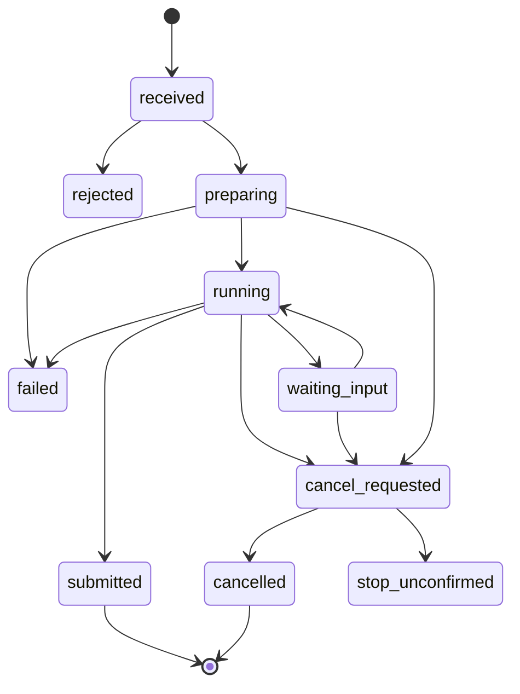

# Execution and recovery

## Run lifecycle

These are local execution states. Reachability, lease authority and server task acceptance are separate fields. `stop_unconfirmed` preserves uncertainty; it is not a claim the process stopped. A submitted result can still be awaiting delivery or review.

## Accept and prepare

1. Validate protocol, command target, deadline, current lease, capability revision and local policy.
2. Persist command, content hash and pending receipt in SQLite. Duplicate content returns the original receipt.
3. Reserve a local slot transactionally; if capacity changed, reject without launch. Server reservation does not override local capacity.
4. Resolve authorized context/artifact references; verify hashes and size limits.
5. Prepare exact source revision, dependencies, environment and approved packages in a run-specific workspace.
6. Record launch intent before invoking the adapter. Launch with a supervised identity and record the resulting process/session handle.
7. Persist sequenced events before delivery. Do not block the control loop on stdout processing.

## Crash window around launch

SQLite cannot atomically commit an OS process launch. Use a durable launch intent and a child/wrapper startup handshake tied to a unique run token. The child must not begin task work until its association has been confirmed. On daemon restart, inspect recorded handles, process start time and token; a PID alone is insufficient because it can be reused.

If state is ambiguous, quarantine the workspace and reconcile with Anode. Do not blindly relaunch the same command. A replacement gets a new attempt ID. Exactly-once process execution is not promised; the system prevents duplicate accepted authority and limits duplicate side effects.

## Heartbeats, sleep and reconnect

The link loop runs independently of harness output and Talo. Persist delivery state and event sequence locally. During network loss, continue only while the lease and owner policy allow; no new server assignments can be invented.

On suspend/resume or detected time discontinuity, check authority before resuming work. Reconcile inventory and renew leases before new side effects. Buffered events can be replayed, but late results may be quarantined by Anode.

If the machine is asleep, Anode may queue the task, select another worker or time out according to assignment policy. Anode cannot push execution into a suspended OS. Optional keep-awake is an explicit owner setting; automatic Wake-on-LAN is outside the first release.

## Questions and follow-up

A harness may emit a question and enter `waiting_input`. The event references the thread message. Anode schedules a lead response; Cnode receives a follow-up command only if the adapter supports it. Do not type into an arbitrary terminal or guess undocumented desktop UI behavior.

Serialize turns per session. Record session revision and reject stale follow-ups. If the process has ended, resume through a supported adapter or start a new run with a concise handoff context.

## Cancellation

Cancellation persists a request, signals the supervised process group, waits for configured grace, then escalates under local policy. Report whether stopping was confirmed. A provider call may remain billable after local cancellation; usage reconciliation is separate. Side effects already completed are not undone by a stop signal.

Revoked authority blocks new connector/gateway grants. If the adapter cannot stop safely, block further local tool grants where enforceable, record the limitation and surface owner controls.

## Finish

Collect exact source refs, test evidence, concise outcome and usage references. Upload and finalize artifacts before the terminal result event. Retain local files until Anode acknowledges the result and retention policy allows cleanup. An acknowledged result is not accepted work; the task remains in review.

## Required failure demonstrations

| Fault | Expected result |
| --- | --- |
| Crash before command acknowledgment | Replay produces one durable receipt and no duplicate launch. |
| Crash after launch intent | Recover or quarantine existing process; never blindly relaunch. |
| Disk full | Stop accepting new work; retain existing pending events; report bounded failure. |
| Anode unavailable | Bounded backoff; buffered events remain durable. |
| Lease expires during disconnect | Stop/pause at controllable boundary; late output is non-authoritative. |
| Duplicate terminal event | Original receipt returned; no extra outcome or review turn. |
| Talo/model hangs | Control loop stays alive; task gets bounded tool failure. |
