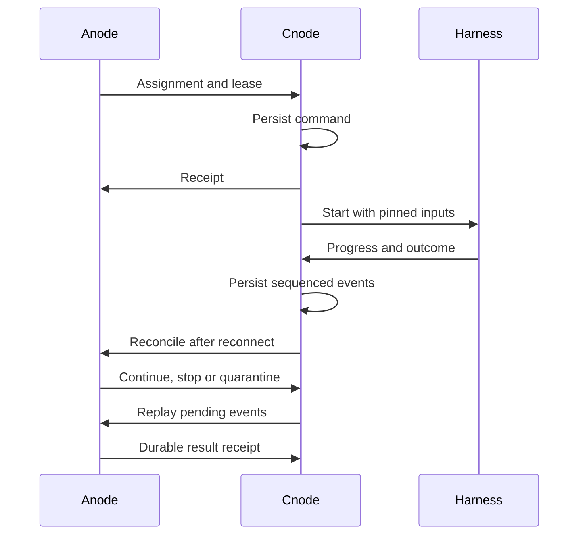

# Anode–Cnode protocol

**Draft 0.1 — proposed contract, not a released API.** Anode is canonical. Cnode vendors this document and `contracts/0.1/` byte-for-byte. Protocol versioning is independent of either application's version.

## 1. Roles and negotiation

Anode owns shared state, command delivery and lease authority. Cnode owns local process state and local execution policy. A runner can expose multiple workers. Version 0.1 supports one connected Anode authority per Cnode profile; different profiles have separate credentials, databases and workspaces.

The baseline transport is outbound HTTPS long polling. A later WebSocket transport must carry the same commands, receipts and replay semantics. No inbound desktop port is required. CLI and MCP are user/harness surfaces, not substitutes for a background connection.

At enrollment, Cnode declares protocol versions, software version, OS/architecture, adapter versions and explicit capabilities. Anode selects an exact mutually supported version. Reject unsupported versions or required capabilities before assignment. Optional extensions must not alter execution semantics unless negotiated.

## 2. Enrollment and credentials

1. An authenticated owner creates a short-lived, single-use enrollment grant scoped to an organization and intended owner.
2. Cnode exchanges it over TLS, binding a generated local device identity. Persist the device secret in the OS credential store.
3. Anode creates a runner identity and scoped access/refresh credentials. Credentials are never placed in assignment JSON or logs.
4. Rotation, revocation and renewal use the enrolled identity. Pending events remain local if authentication fails; no task is started.

The exact authentication backend and token format remain implementation choices. The required behavior is short-lived access, protected refresh material, binding to the correct runner and revocation checks. Loopback standalone mode also authenticates callers; loopback is not an authorization boundary.

## 3. Proposed HTTP surface

All paths are relative to the Anode origin. Request and response bodies are JSON unless an artifact transfer or model stream states otherwise. Limits below are initial defaults to validate, not performance claims.

| Method and route | Purpose / minimum contract |
| --- | --- |
| `POST /v1/runner-enrollments/exchange` | Single-use grant + device identity + supported versions → runner ID, selected protocol and protected credential response. |
| `PUT /v1/runners/{runner_id}/capabilities` | Full capability revision with expected previous revision → accepted revision. |
| `GET /v1/runners/{runner_id}/commands?after={cursor}&wait_seconds=25` | Return ordered commands and `next_cursor`; empty success is valid. Maximum 100 commands. |
| `POST /v1/runners/{runner_id}/commands/{command_id}/ack` | Persisted/rejected receipt with body hash → stable server receipt. |
| `POST /v1/runners/{runner_id}/heartbeat` | Availability, active inventory and capacity use → server time and next heartbeat guidance. Does not renew leases. |
| `POST /v1/runs/{run_id}/lease-renewals` | Current epoch and runner identity → renewed expiry or typed rejection. |
| `POST /v1/runs/{run_id}/events` | Ordered batch of at most 100 sequenced events → durable receipts and highest contiguous accepted sequence. |
| `POST /v1/runners/{runner_id}/reconcile` | Cursor, pending receipts and run inventory → replay cursor and continue/stop/quarantine decisions. |
| `POST /v1/runs/{run_id}/credential-grants` | Request an allowed purpose for the active run → short-lived scoped credential or denial. |
| `POST /v1/artifacts/uploads` | Project/run, content type, size and hash → scoped upload instructions. |
| `POST /v1/artifacts/{artifact_id}/finalize` | Verify completed transfer → immutable artifact reference. |
| `POST /v1/artifacts/{artifact_id}/access` | Authorize read → bounded transfer instructions. |

Body budget: 1 MiB per control request, with smaller configured event limits where useful. Large output belongs in artifacts. Apply maximum sizes before deserialization. The event and assignment JSON fixtures cover the core wire objects; this package is not a complete OpenAPI definition.

## 4. Delivery and command contract

The command stream includes `assign`, `cancel` and `follow_up`. The included JSON Schema specifies `assign`; cancel and follow-up payloads below must be added to machine-readable schemas before those features ship.

Every command has `protocol_version`, `command_id`, `kind`, `runner_id`, `project_id`, `run_id`, `lease_epoch`, `issued_at` and `expires_at`. Assignment additionally pins worker, task/revision, optional lead generation, lease expiry, context, workspace, package lock, execution policy and deadline. See [assignment fixture](../contracts/0.1/examples/assignment.json).

`cancel` adds `reason` and `grace_seconds`; it references an existing run. `follow_up` adds `message_refs` and `expected_session_revision`; it is legal only when that run/session supports follow-up. A terminated run requires a new run and may resume a provider session only through an explicitly supported adapter operation. A question with `waiting_input` retains the run but may release a compute slot only if an explicit reservation policy says so.

Cnode must commit a command and its content hash to local storage before acknowledgment. Acknowledgment means receipt, not process launch or task acceptance. Persist the replay cursor only after the corresponding command batch is durable. Anode retains command bodies until acknowledged or expired under explicit retention policy; a response cursor alone never acknowledges execution.

For repeated `command_id` with identical content, return the original receipt and never start a second process. The same ID with different content returns `idempotency_conflict`. A command can be rejected with a typed reason after durable receipt, such as unavailable capability or denied local policy.

## 5. Lease and deadline semantics

Proposed test defaults: heartbeat 20 seconds, runner unreachable after 90 seconds, run lease TTL 120 seconds, renew every 30 seconds. These values are configurable and must be validated under real sleep/network conditions. Heartbeat, run lease and lead generation are distinct.

Anode returns authoritative expiry and server time. Cnode uses a conservative monotonic deadline derived from that response; wall-clock changes cannot extend a lease. A shorter task deadline or local runtime limit wins.

On expiry or ambiguous authority, block new side effects and request pause/stop at the next controllable boundary. If an adapter cannot pause safely, request cancellation and record unresolved process state if stopping fails. A disconnected process may continue computing; no design can promise otherwise merely from server lease expiry.

Anode may replace an expired attempt only under retry policy. A replacement has a new `run_id` and a higher task execution epoch; the old run/epoch remains in history. All connector actions and accepted state mutations check current authority. The old run's late results are stored as `late_quarantined` evidence, not treated as current work.

## 6. Events and outcomes

Each event has a globally unique `event_id`, `run_id`, `lease_epoch`, per-run monotonic `sequence` starting at 1, `happened_at`, `type` and typed payload. The server records its own `received_at`; callers cannot set it. See [event schema](../contracts/0.1/event.schema.json).

Supported fixture types: `run.started`, `run.progress`, `run.waiting_input`, `run.failed`, `run.cancelled` and `run.result_submitted`. Submitting a result is the execution output, not an acceptance decision. The result includes summary, takeaways, evidence refs, optional source submission, questions and usage refs. Failed attempts can upload diagnostic artifacts without inventing a successful result.

Anode deduplicates by event ID and `(run_id, sequence)`. Identical repeats return the same receipt. Conflicting reuse fails. If a batch has a gap, accept only the contiguous prefix and return `sequence_gap` with `expected_sequence`; Cnode resends from there. Unknown event types cannot advance the cursor. Duplicate checks occur before terminal-state checks so a previously accepted terminal event can be safely retried.

Result receipt example:

```json
{"event_id":"evt-demo-002","run_id":"run-demo-001","sequence":2,"disposition":"recorded","received_at":"2026-11-15T12:01:00Z","task_state":"awaiting_review"}
```

Dispositions are `recorded`, `duplicate` or `late_quarantined`. Duplicates reference the original receipt; they do not create another charge, outcome or review turn.

## 7. Reconnect and process recovery



Reconnect inventory includes run ID, lease epoch, last local state, process identity, highest generated/acknowledged event sequence and adapter session reference. Anode returns a decision for every reported run and pending server run absent locally. Cnode must not adopt a newer lease merely because it still has an old process.

Use `continue` only with fresh authority, `stop` for revoked/cancelled work, and `quarantine` for late or ambiguous output. A server run missing locally becomes a recovery problem; do not silently launch it again before resolving whether a prior process survives. Retries receive new attempt IDs.

## 8. Artifacts and repository content

Assignments carry opaque `artifact://...` references. These are identifiers resolved through the authorized API, not arbitrary URLs to fetch. Content transfers are scoped to the run/project, bounded by size and hash, and finalized before references are submitted. Cnode validates both archive extraction and checkout paths.

Workspace modes: `none` for non-code tasks, `git_bundle` for mediated exchange, or `authorized_clone` for explicitly granted contributor/bot access. Git mode pins repository, exact base commit, allowed task ref and target ref. Anode and connector validate actual history; a provided result SHA is not proof.

Do not send provider, Git or device credentials in artifacts. Source code already delivered to another owner cannot be erased by revoking a grant.

## 9. Errors and retries

```json
{"error":{"code":"stale_lease","message":"Run authority has expired","retryable":false,"details":{"run_id":"run-demo-001"}},"request_id":"req-demo-001"}
```

| Code | Meaning / caller behavior |
| --- | --- |
| `unauthenticated`, `permission_denied` | Renew credentials if appropriate; never widen scope automatically. |
| `unsupported_protocol`, `capability_unavailable` | Negotiate or stop; do not substitute silently. |
| `stale_lease`, `stale_role_generation` | Reconcile; old authority cannot be revived by retrying. |
| `revision_conflict`, `idempotency_conflict` | Fetch state and resolve explicitly. |
| `sequence_gap` | Replay from server's expected sequence. |
| `local_policy_denied`, `workspace_invalid` | Reject assignment with evidence; owner policy remains authoritative locally. |
| `budget_exhausted` | Stop new inference; return a budget-blocked outcome. |
| `rate_limited`, `temporarily_unavailable` | Bounded exponential backoff with jitter; honor retry guidance and deadlines. |

Only transport retry of an already identified, idempotent operation is automatic. A retry of a model call, process launch or external publication is a separate decision with potentially billable or irreversible effects.

## 10. Contract evolution and conformance

Anode edits the canonical version and publishes an immutable contract release. Cnode updates its pinned copy through a reviewed change, preserving an integrity manifest. Changing required fields or execution semantics requires a new protocol version. No unnegotiated new enum value can trigger execution.

The included schemas reject unknown fields, so even additive wire fields require an updated negotiated contract in draft 0.x. Application versions can otherwise change independently. Do not compare version numbers as decimal floats.

Conformance must cover duplicate commands, conflicting payload reuse, crash-before/after acknowledgment, event gaps, late result quarantine, expired lease, stale lead generation, unsupported adapter, cross-project artifacts and artifact finalization failure. Fake peers should exercise these cases before real model integration.
