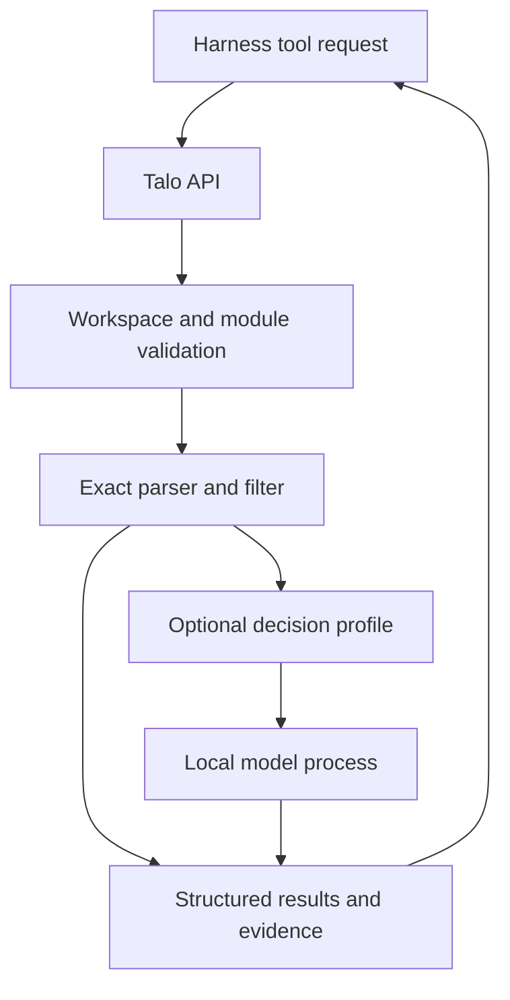
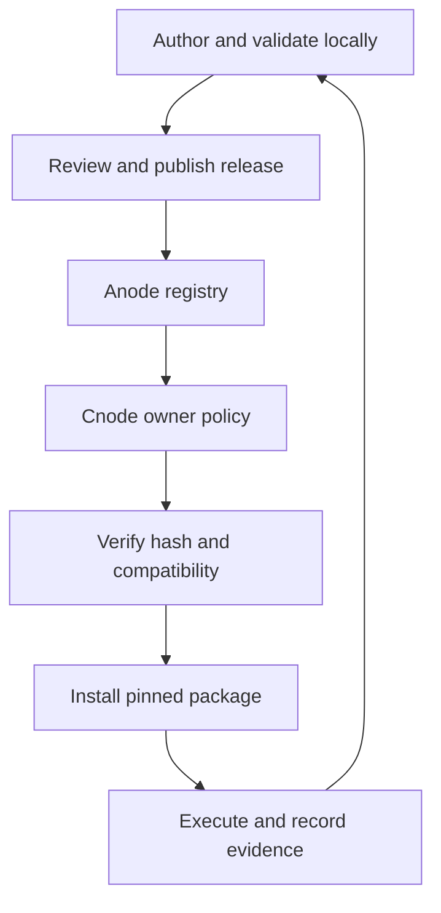

# Talo and reusable capabilities

## Integration decision

Ship one Cnode installation experience that can supervise Talo, while keeping Talo a separately versioned, independently usable service. Cnode owns machine connection and job execution; Talo owns local helper execution, model lifecycle and workspace result references. Do not merge those control loops into a process that can be blocked by inference.

## Tool surface

Use Talo's existing proposed operations: `discover`, `describe`, `run`, `decide` and `inspect`. CLI and MCP adapters reach a user-scoped local socket. Each call is bound to a workspace and policy. Input is exactly one workspace-relative path, small inline value or result reference.

Start with exact modules such as `tests.diff`, `logs.trace`, `changes.map` and `i18n.check`. The first integration compares baseline/current test reports, returns stable test IDs and lets the harness inspect a failure's evidence without rereading the full report.

Decision profiles support routing, triage and independent multi-selection over explicit allowed outputs. They can abstain. Separate uncertain results, unprocessed input and display truncation. Missing model state must not disable deterministic helpers.

## Local versus shared evidence

A Talo `result://...` reference is local to its workspace. It is not usable by another machine. Cnode must export an authorized evidence subset to an Anode artifact and attach its revision/hash before sharing. Preserve source IDs and module/profile/checkpoint versions. Do not upload all local source files just to make one reference portable.

## Package types

| Type | Contents |
| --- | --- |
| Helper | Executable parser/filter/validator with input/output schemas. |
| Pipeline | Declarative composition of versioned approved operations. |
| Decision profile | Allowed outputs, model requirement and evaluation fixtures. |
| Skill | Instructions for a harness to use capabilities, with adapter-specific installation when required. |
| Bundle | Pinned set of compatible capabilities. |

Release metadata includes ID, owner, visibility, immutable version, content hash, runtime/OS/architecture, dependency pins, schemas, requested mounts/network/secrets, resource limits, license and validation evidence. Model redistribution requires its own license check.

Begin with trusted built-ins and declarative pipelines. Arbitrary executable extensions remain disabled until an enforced sandbox is implemented. Fixture success establishes observed behavior, not permission or safety. Installing a skill must not grant new local or server privileges.

Updates install a new immutable version; running jobs stay on their lock. Rollback selects a previous approved version. Revocation blocks new execution and flags impacted runs; it cannot erase downloaded copies or unilaterally revoke another owner's filesystem access.

## Quality and cost

Measure total main-model input/output tokens, task success, latency, retries and evidence inspection across normal harness, exact helpers, and exact-plus-model modes. Use held-out tasks. Agree on accuracy tolerance before enabling a decision profile. Local probabilistic output never replaces permission checks, lease enforcement or budget accounting.

Talo's checkpoint remains an evaluation decision. Its existing design identifies Laya as an adapter candidate; this repository does not select it as a validated default.
